# 컴퓨터에게 명령 내리는 말(파이썬) 처음 배우기

## 1. 미션의 핵심 요약

세 가지 결과물을 만드는 미션입니다.

| 영역 | 핵심 요구 |
| --- | ----- |
| 동작하는 프로그램 |	터미널에서 돌아가는 퀴즈 게임 |
| 코드 구조	| 클래스 2개 이상 + state.json 저장 |
| Git 관리 |	커밋 10개↑, 브랜치 병합, clone/pull 실습 |

## 2. 필요한 기술 요소 분석

요구사항을 기술별로 분류하면 이렇게 나뉩니다.

### (1) Python 기초 문법

- 변수 / 자료형: dict로 퀴즈 1개 표현, list로 여러 퀴즈 관리

- 조건문: 메뉴 선택, 정답 판정

- 반복문: while(메뉴 루프), for(문제 순회)

- 함수: 입력 처리, 출력 처리를 쪼개기

### (2) 클래스 (2개 필수)

- Quiz : 문제 하나를 표현

- QuizGame : 게임 전체 흐름 관리

### (3) 파일 입출력

- json 모듈 (표준 라이브러리, 설치 불필요)

- try/except로 예외 처리

### (4) Git

- 명령어 7종 + 브랜치 + clone/pull

## 3. 클래스 구조 설계

```
import json

class Quiz:
    """퀴즈 1개를 표현하는 클래스"""
    def __init__(self, question, choices, answer):
        self.question = question    # 문제 (str)
        self.choices = choices      # 선택지 4개 (list)
        self.answer = answer        # 정답 번호 1~4 (int)

    def show(self):
        """문제와 선택지를 화면에 출력"""
        print(self.question)
        for i, choice in enumerate(self.choices, start=1):
            print(f"  {i}. {choice}")

    def is_correct(self, user_input):
        """사용자가 입력한 번호가 정답인지 확인"""
        return user_input == self.answer

    def to_dict(self):
        """JSON 저장용으로 dict 변환"""
        return {
            "question": self.question,
            "choices": self.choices,
            "answer": self.answer,
        }

class QuizGame:
    """게임 전체를 관리하는 클래스"""
    def __init__(self):
        self.quizzes = []       # Quiz 객체 리스트
        self.best_score = 0     # 최고 점수
        self.filename = "state.json"

    def run(self):
        """메뉴 루프 (프로그램 시작점)"""
        ...
```

## 4. 메뉴 루프의 뼈대
```
def run(self):
    self.load()  # 시작 시 파일 불러오기
    while True:
        try:
            print("\n===== 퀴즈 게임 =====")
            print("1. 퀴즈 풀기")
            print("2. 퀴즈 추가")
            print("3. 퀴즈 목록")
            print("4. 점수 확인")
            print("5. 종료")

            choice = input("선택: ").strip()  # 앞뒤 공백 제거

            if choice == "":
                print("입력이 비어 있습니다. 다시 선택하세요.")
                continue
            if not choice.isdigit():
                print("숫자만 입력하세요.")
                continue

            choice = int(choice)
            if choice == 1:
                self.play()
            elif choice == 2:
                self.add_quiz()
            elif choice == 3:
                self.show_list()
            elif choice == 4:
                self.show_score()
            elif choice == 5:
                self.save()
                print("프로그램을 종료합니다.")
                break
            else:
                print("1~5 사이 번호를 선택하세요.")

        except (KeyboardInterrupt, EOFError):
            print("\n안전하게 저장 후 종료합니다.")
            self.save()
            break
```

## 5. 파일 저장 / 불러오기 핵심
```
def save(self):
    data = {
        "quizzes": [q.to_dict() for q in self.quizzes],
        "best_score": self.best_score,
    }
    try:
        with open(self.filename, "w", encoding="utf-8") as f:
            json.dump(data, f, ensure_ascii=False, indent=2)
    except OSError:
        print("저장 중 오류가 발생했습니다.")

def load(self):
    try:
        with open(self.filename, "r", encoding="utf-8") as f:
            data = json.load(f)
        self.quizzes = [
            Quiz(q["question"], q["choices"], q["answer"])
            for q in data["quizzes"]
        ]
        self.best_score = data["best_score"]
    except FileNotFoundError:
        print("저장 파일이 없어 기본 퀴즈로 시작합니다.")
        self.load_default()
    except (json.JSONDecodeError, KeyError):
        print("파일이 손상되어 기본 퀴즈로 복구합니다.")
        self.load_default()
```

## 6. Git 작업 순서 
```
# 1. 초기 설정
git init
git add .gitignore README.md
git commit -m "Chore: 프로젝트 초기 설정"

# 2~5. 기능별 커밋 (main)
git commit -m "Feat: 메뉴 기능 구현"
git commit -m "Feat: Quiz 클래스 작성"
git commit -m "Feat: 기본 퀴즈 데이터 추가"

# 6. 브랜치 작업 (퀴즈 풀기)
git checkout -b feature/play
git commit -m "Feat: 퀴즈 풀기 기능 구현"
git checkout main
git merge feature/play          # ← 병합 기록 생성

# 7~ . 나머지 기능들
git commit -m "Feat: 퀴즈 추가 기능"
git commit -m "Feat: 점수 저장 기능"
git commit -m "Feat: JSON 파일 입출력"
git commit -m "Docs: README 작성"
```

```
# clone / pull 실습
git push                        # 먼저 GitHub에 올리고

cd ..
git clone <저장소URL> quiz-copy  # ← clone 기록
cd quiz-copy
# README 한 줄 수정 후
git commit -am "Docs: README 설명 추가"
git push

cd ../원래폴더
git pull                        # ← pull 기록
```

## 7. 작업 순서 (체크리스트)

- [x] 01. GitHub 저장소 생성 → clone 또는 init
- [x] 02. .gitignore, README.md 만들고 첫 커밋/푸시
- [x] 03. Quiz 클래스 작성 → 커밋
- [x] 04. 기본 퀴즈 5개 작성 → 커밋
- [x] 05. 메뉴 루프 + 입력 검증 → 커밋
- [x] 06. (브랜치) 퀴즈 풀기 기능 → 병합
- [ ] 07. 퀴즈 추가 기능 → 커밋
- [ ] 08. 퀴즈 목록 기능 → 커밋
- [ ] 09. 점수 확인 + 저장 → 커밋
- [x] 10. JSON 저장/불러오기 완성 → 커밋
- [ ] 11. README 완성 → 푸시
- [ ] 12. clone/pull 실습
- [x] 13. 스크린샷 4종 캡처

### 01. GitHub 저장소 생성 → clone 또는 init
```
# 뒤에 E1-2를 붙이지 않으면 GitHub 저장소 이름 그대로 폴더가 생성됨.
hcv70714678@GNIA-C202-A06:~/projects$ git clone https://github.com/yoga9137/E1-2.git
Cloning into 'E1-2'...
remote: Enumerating objects: 103, done.
remote: Counting objects: 100% (103/103), done.
remote: Compressing objects: 100% (78/78), done.
remote: Total 103 (delta 20), reused 90 (delta 15), pack-reused 0 (from 0)
Receiving objects: 100% (103/103), 32.76 KiB | 2.98 MiB/s, done.
Resolving deltas: 100% (20/20), done.

# 받은 파일들 확인.
hcv70714678@GNIA-C202-A06:~/projects$ ls -al
total 12
drwxr-xr-x 3 hcv70714678 hcv70714678 4096 Nov 11 17:27 .
drwxr-x--- 9 hcv70714678 hcv70714678 4096 Nov 11 15:43 ..
drwxr-xr-x 4 hcv70714678 hcv70714678 4096 Nov 11 17:27 E1-2

# E1-2 폴더로 이동.
hcv70714678@GNIA-C202-A06:~/projects$ cd E1-2/

# 폴더 내용 확인.
hcv70714678@GNIA-C202-A06:~/projects/E1-2$ ls -al
total 16
drwxr-xr-x 4 hcv70714678 hcv70714678 4096 Nov 11 17:27 .
drwxr-xr-x 3 hcv70714678 hcv70714678 4096 Nov 11 17:27 ..
drwxr-xr-x 7 hcv70714678 hcv70714678 4096 Nov 11 17:28 .git
drwxr-xr-x 2 hcv70714678 hcv70714678 4096 Nov 11 17:27 QuizGame

# VS Code 에서 편집하기위해 실행.(자동 연동).
hcv70714678@GNIA-C202-A06:~/projects/E1-2$ code .
```

### 02. .gitignore, README.md 만들고 첫 커밋/푸시
```
# .gitignore 파일과 README.md 파일 생성.
hcv70714678@GNIA-C202-A06:~/projects/E1-2$ touch .gitignore README.md

# README.md 파일에 내용 쓰기.
hcv70714678@GNIA-C202-A06:~/projects/E1-2$ echo "# E1-2 Project" >> README.md

# .gitignore 파일에 내용 쓰기.
# 참고: .gitignore에는 GitHub에 올리지 않을 보안 키 파일이나 임시 폴더
# 이름을 적어둡니다.
hcv70714678@GNIA-C202-A06:~/projects/E1-2$ echo -e ".env\n__pycache__/\nnode_modules/\n.vscode/" >> .gitignore

# 원격 저장소 연결.
hcv70714678@GNIA-C202-A06:~/projects/E1-2$ git remote add origin https://github.com/yoga9137/E1-2.git

# 로컬 컴퓨터의 커밋 기록 push.(강제푸시).
hcv70714678@GNIA-C202-A06:~/projects/E1-2$ git push -f origin main
Enumerating objects: 4, done.
Counting objects: 100% (4/4), done.
Delta compression using up to 24 threads
Compressing objects: 100% (2/2), done.
Writing objects: 100% (4/4), 338 bytes | 338.00 KiB/s, done.
Total 4 (delta 0), reused 0 (delta 0), pack-reused 0 (from 0)
To https://github.com/yoga9137/E1-2.git
 + a9b8269...56ba828 main -> main (forced update)
```


### 03. Quiz, QuizGame 클래스 작성 → 커밋

```
# QuizGame 폴더 아래에 main.py 프로그램 작성.

"""
파이썬 퀴즈 게임 (보너스 기능 추가 버전)
- Quiz 클래스: 퀴즈 1개를 표현
- QuizGame 클래스: 게임 전체를 관리
- state.json에 퀴즈/최고점수 저장 (UTF-8)
"""

import json
import os


# ============================================================
# Quiz 클래스: 퀴즈 1개를 표현.
# ============================================================
class Quiz:
    def __init__(self, question, choices, answer):
        self.question = question
        self.answer = answer


# ============================================================
# QuizGame 클래스: 게임 전체를 관리.
# ============================================================
class QuizGame:
    FILENAME = "state.json"

    def __init__(self):
        self.quizzes = []
        self.high_score = 0
        self.score = 0        

    # ---------------- 메뉴 루프 ----------------
    def run(self):
        pass


# ============================================================
# 프로그램 메인 실행.
# ============================================================
if __name__ == "__main__":
    game = QuizGame()
    game.run()
```

```
# 모든 변경내용을 스테이징.
hcv70714678@GNIA-C202-A06:~/projects/E1-2$ git add .

# Quiz, QuizGame 클래스 작성 → 커밋
hcv70714678@GNIA-C202-A06:~/projects/E1-2$ git commit -m "Feat: Quiz, QuizGame 클래스 작성"
[main a276092] Feat: Quiz, QuizGame 클래스 작성
 2 files changed, 107 insertions(+)
 create mode 100644 QuizGame/main.py
 create mode 100644 QuizGame/state.json 

# 깃허브에 커밋한 내용을 푸시. 
hcv70714678@GNIA-C202-A06:~/projects/E1-2$ git push -u origin main
Enumerating objects: 6, done.
Counting objects: 100% (6/6), done.
Delta compression using up to 24 threads
Compressing objects: 100% (5/5), done.
Writing objects: 100% (5/5), 1.29 KiB | 1.29 MiB/s, done.
Total 5 (delta 0), reused 0 (delta 0), pack-reused 0 (from 0)
To https://github.com/yoga9137/E1-2.git
   56ba828..a276092  main -> main
branch 'main' set up to track 'origin/main'. 
```

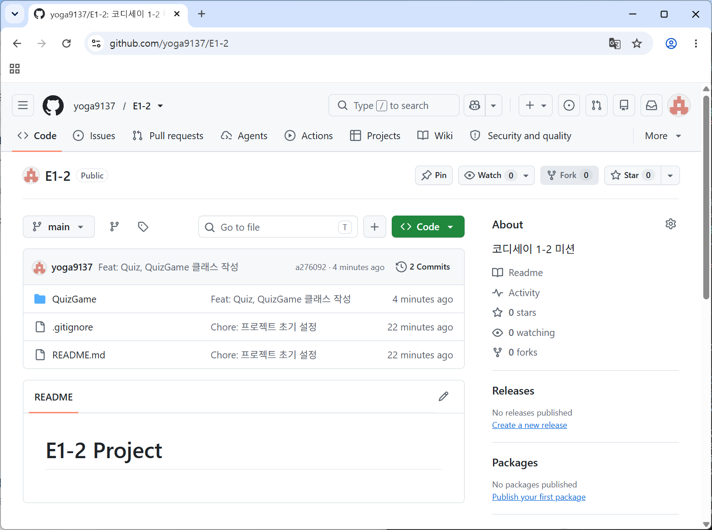

### 04. 기본 퀴즈 5개 작성 → 커밋

```
# QuizGame 클래스에 메소드 추가.
def load_default(self):
    """파일이 없거나 손상됐을 때 사용할 기본 퀴즈 5개"""
    default_data = [
        ("대한민국의 수도는?",
            ["부산", "서울", "대구", "인천"], 2),
        ("태양계에서 가장 큰 행성은?",
            ["지구", "화성", "목성", "토성"], 3),
        ("물의 화학 기호는?",
            ["H2O", "CO2", "O2", "NaCl"], 1),
        ("1년은 며칠일까요? (평년 기준)",
            ["364일", "365일", "366일", "367일"], 2),
        ("무지개의 색은 보통 몇 가지로 표현할까요?",
            ["5가지", "6가지", "7가지", "8가지"], 3),
    ]
    self.quizzes = [Quiz(q, c, a) for q, c, a in default_data]
    self.high_score = 0
```

#### 1) VS Code 에서 git add, git commit, git push 실행 (추천)

>\> 변경사항 적용 -> 스테이징 -> 커밋 버튼 클릭.

>\> 그래프 영역에 커밋 기록 표시됨.

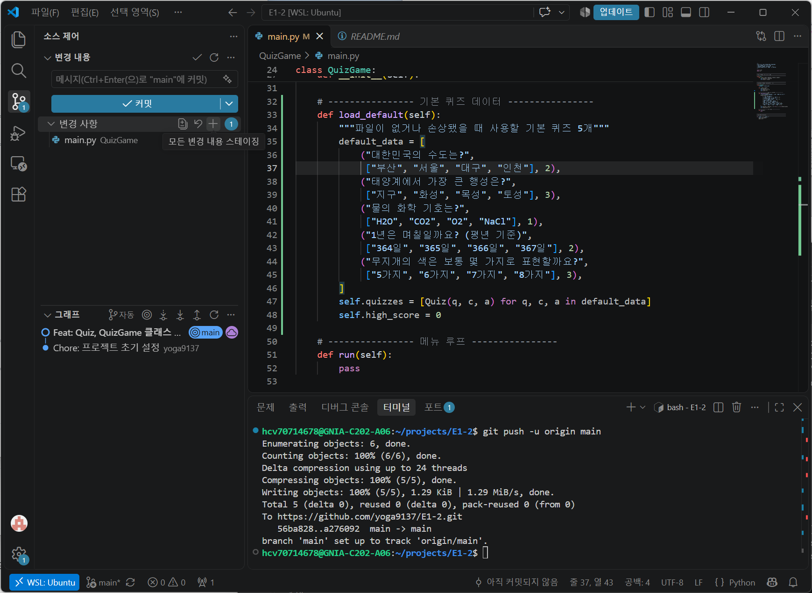

>\> 변경 내용 동기화 클릭 (푸시).

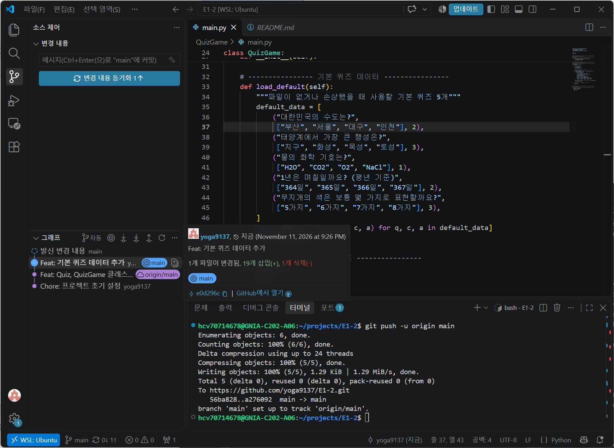

>\> 깃허브 main.py 변경 내용 확인.

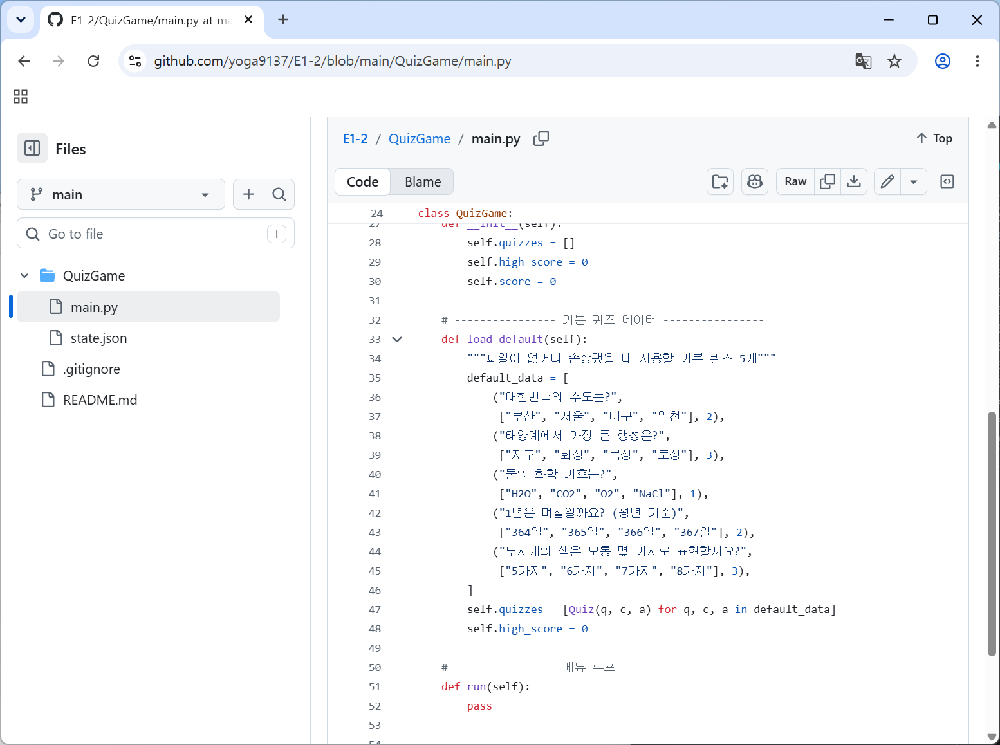

### 05. 메뉴 루프 + 입력 검증 → 커밋

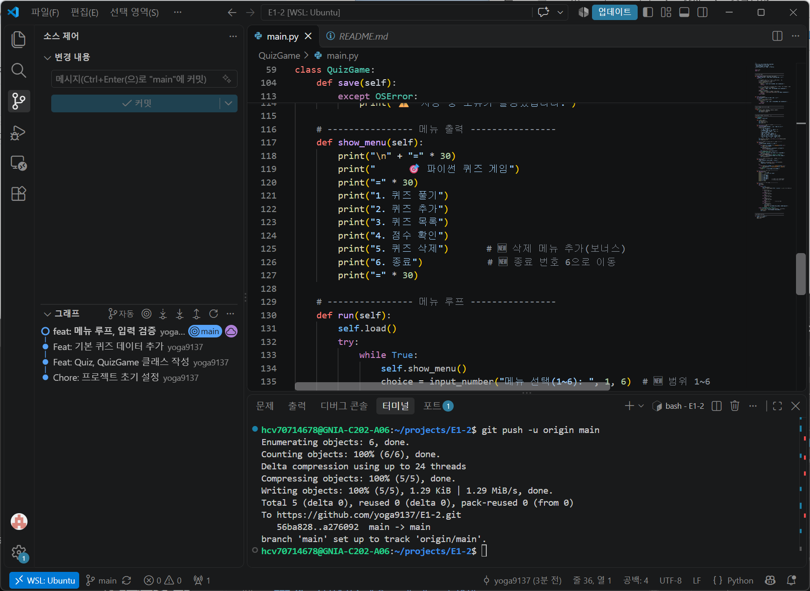

>\> 메뉴 실행 및 입력값 검증

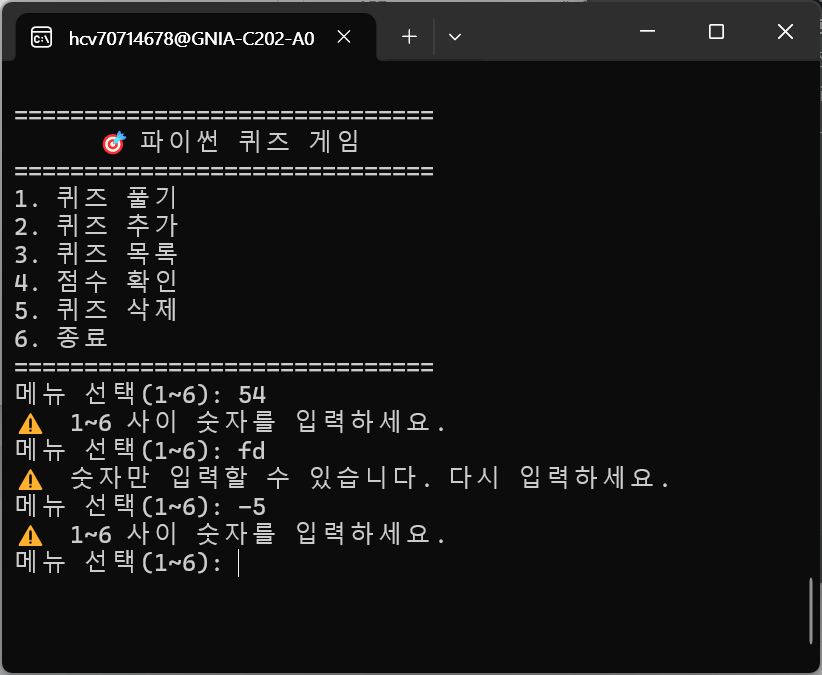

### 06. (브랜치) 퀴즈 풀기 기능 → 병합

먼저, 새 브랜치를 만들기 전에 기준이 되는 main 브랜치가 원격 저장소의 최신 상태와 일치하도록 동기화합니다.
```
# main 브랜치로 이동.
hcv70714678@GNIA-C202-A06:~/projects/E1-2$ git switch main
Already on 'main'
Your branch is up to date with 'origin/main'.

# 최신 코드 내려받기(원격 저장소의 변경 사항을 로컬로 가져옴).
hcv70714678@GNIA-C202-A06:~/projects/E1-2$ git pull origin main
From https://github.com/yoga9137/E1-2
 * branch            main       -> FETCH_HEAD
Already up to date.

# 새 브랜치 생성 및 이동.(접두사: feature/)
hcv70714678@GNIA-C202-A06:~/projects/E1-2$ git switch -c feature/play
Switched to a new branch 'feature/play'

# 브랜치 전환 확인: 현재 위치가 새 브랜치로 바뀌었는지 목록에서 * 표시로 확인
hcv70714678@GNIA-C202-A06:~/projects/E1-2$ git branch
* feature/play
  main
```

>\> VS Code 왼쪽 하단에 main 에서 feature/play 브랜치로 전환 확인.
전환된 브랜치에서 main.py 퀴즈 풀기 기능 작업함.

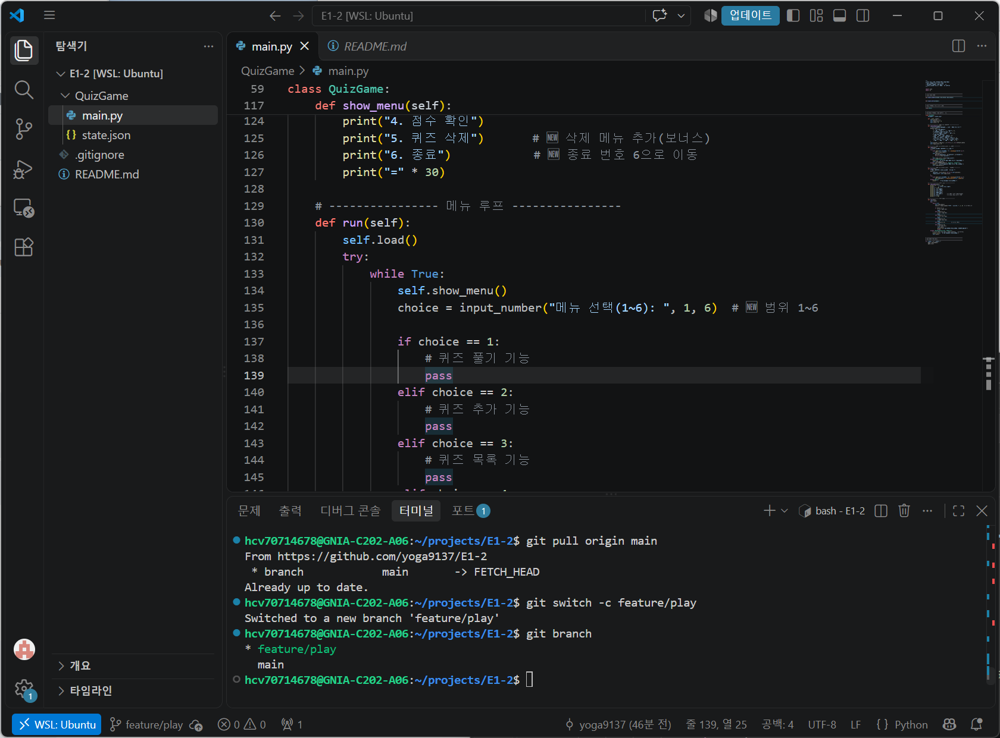

```
# 변경 사항 스테이징.
hcv70714678@GNIA-C202-A06:~/projects/E1-2$ git add .
hcv70714678@GNIA-C202-A06:~/projects/E1-2$ git commit -m 
error: switch `m' requires a value

# # 변경 사항 커밋.
hcv70714678@GNIA-C202-A06:~/projects/E1-2$ git commit -m "feat: 퀴즈풀기 기능추가"
[feature/play efc9e32] feat: 퀴즈풀기 기능추가
 1 file changed, 49 insertions(+), 1 deletion(-)
```

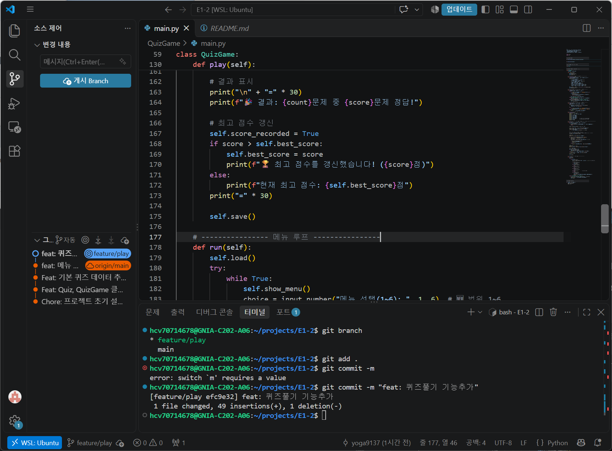

```
# 로컬에만 존재하는 새 브랜치를 GitHub 원격 저장소에도 똑같이 생성하며 업로드, 처음 푸시할 때는 -u 옵션을 붙여 로컬 브랜치와 원격 브랜치를 연결해줌.
hcv70714678@GNIA-C202-A06:~/projects/E1-2$ git push -u origin feature/play
Enumerating objects: 7, done.
Counting objects: 100% (7/7), done.
Delta compression using up to 24 threads
Compressing objects: 100% (4/4), done.
Writing objects: 100% (4/4), 1.27 KiB | 1.27 MiB/s, done.
Total 4 (delta 1), reused 0 (delta 0), pack-reused 0 (from 0)
remote: Resolving deltas: 100% (1/1), completed with 1 local object.
remote: 
remote: Create a pull request for 'feature/play' on GitHub by visiting:
remote:      https://github.com/yoga9137/E1-2/pull/new/feature/play
remote: 
To https://github.com/yoga9137/E1-2.git
 * [new branch]      feature/play -> feature/play
branch 'feature/play' set up to track 'origin/feature/play'.
```

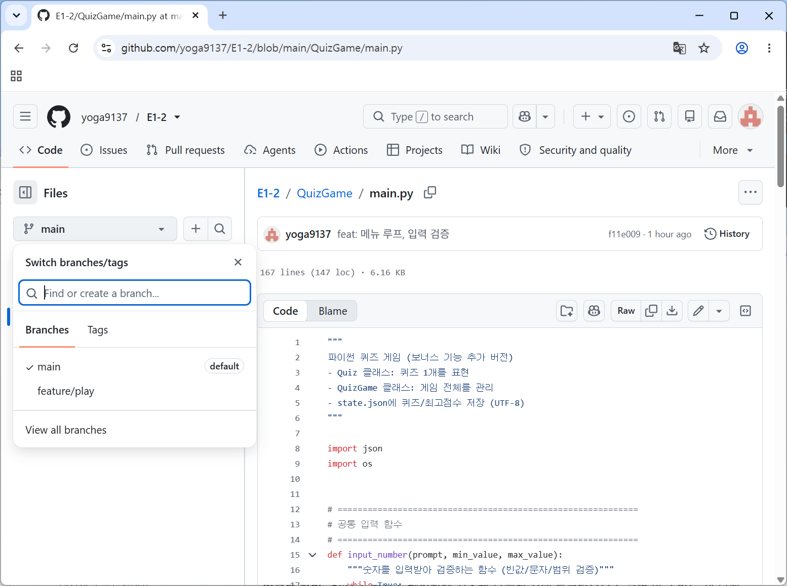

새 브랜치에서 작업을 마친 뒤 main 브랜치로 코드를 합치는 방법은 크게 GitHub 웹사이트에서 Pull Request(PR)를 이용하는 방식(권장)과 VS Code 터미널에서 직접 병합(Merge)하는 방식 두 가지가 있습니다.

#### 1. GitHub 웹사이트에서 Pull Request(PR)로 합치는 방식(권장)

#### 1단계. (Pull Request 생성)
 GitHub 저장소 페이지로 이동하면 상단에 노란색 알림 박스로 Compare & pull request 버튼이 뜹니다. 이 버튼을 클릭한 뒤 제목과 작업 내용을 적고 Create pull request를 누릅니다.

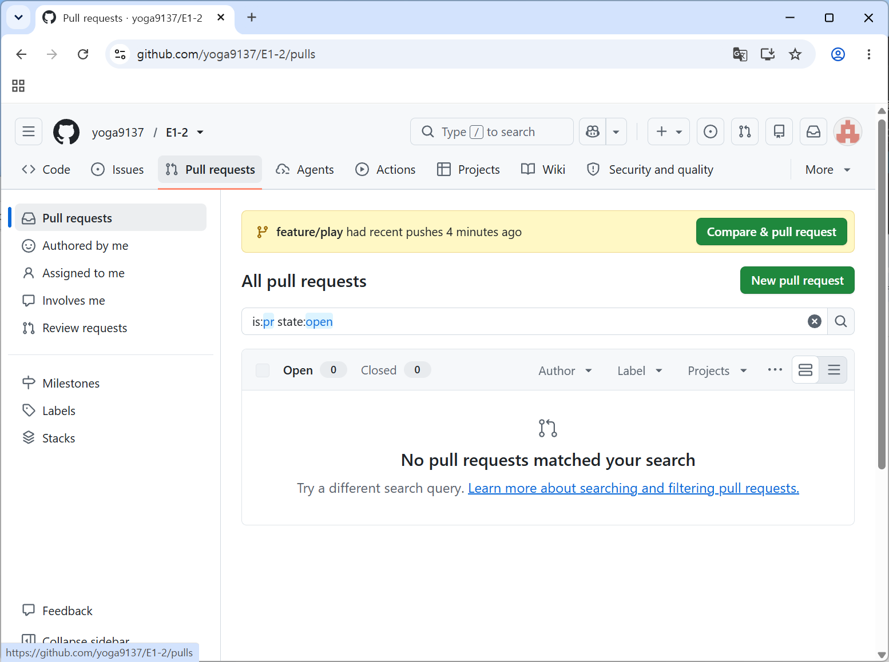

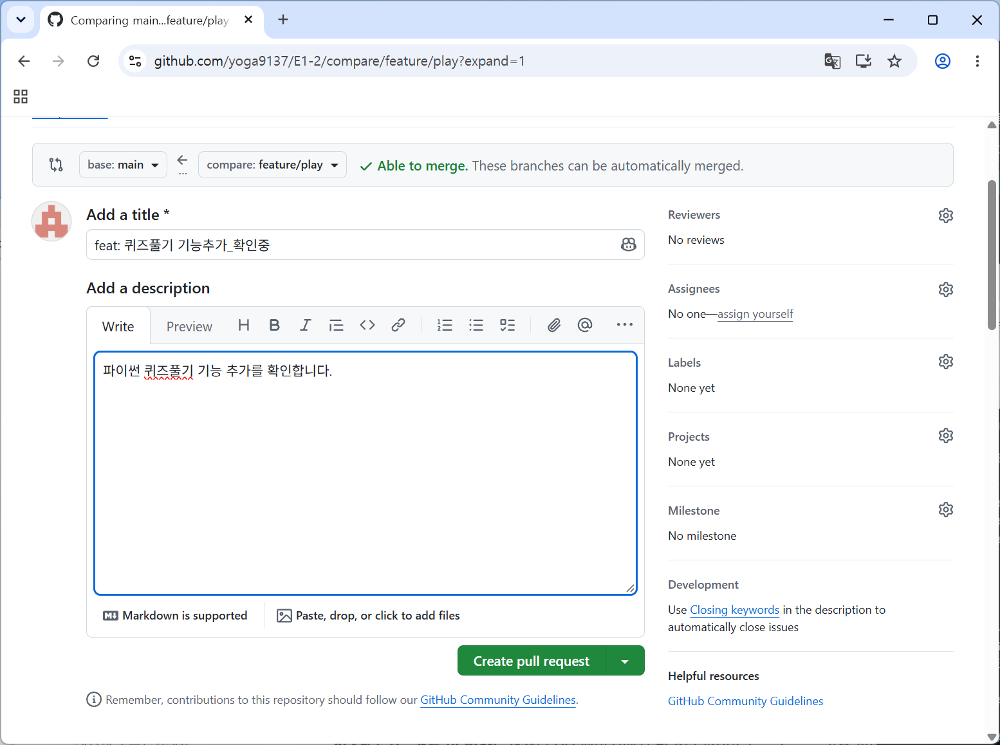

#### 2단계. (코드 검토 및 병합)
 생성된 PR 페이지에서 변경된 파일(Files changed)을 확인한 뒤 문제가 없다면 Merge status 버튼을 클릭하고 우측의 초록색 Merge pull request 버튼과 Confirm merge 버튼을 차례로 클릭합니다.

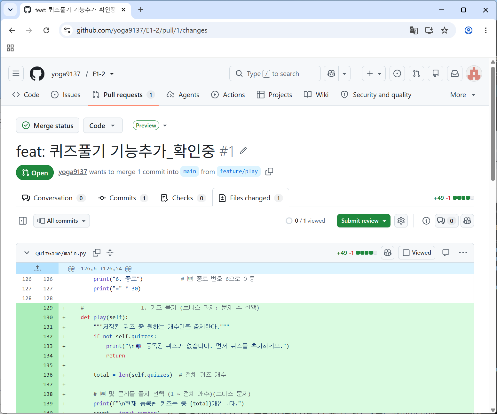

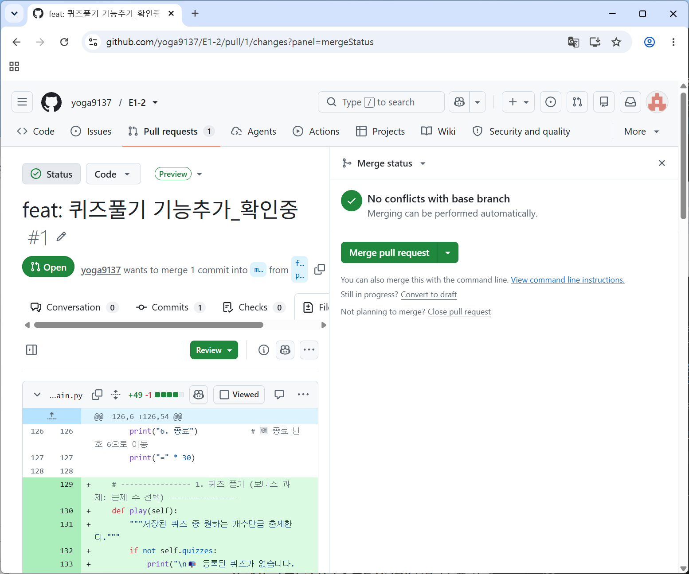

>\> 설명이 필요하면 입력해서 Confirm merge 버튼 클릭.

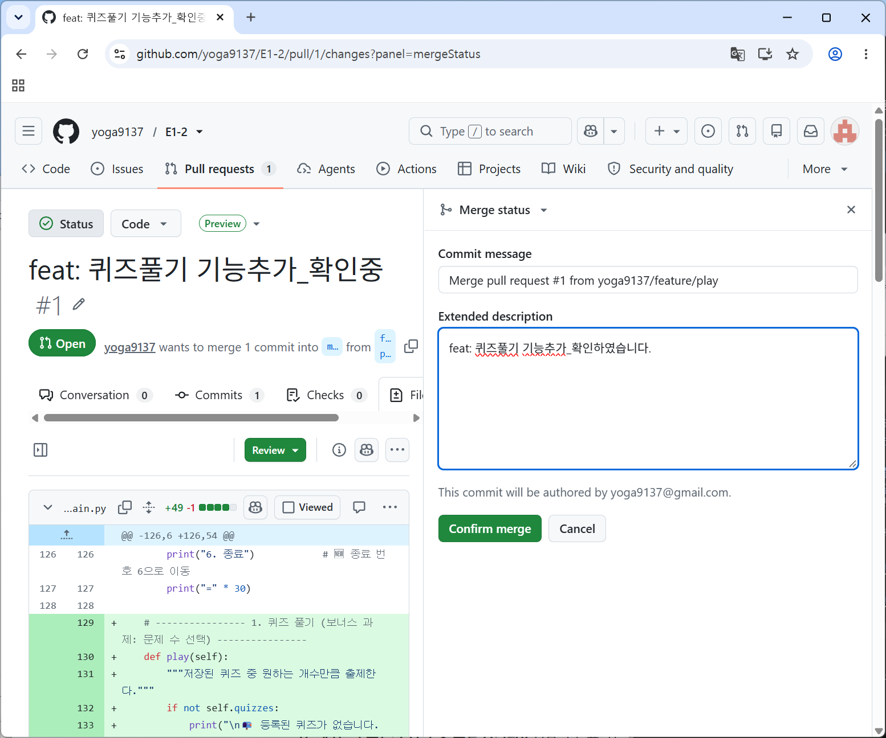

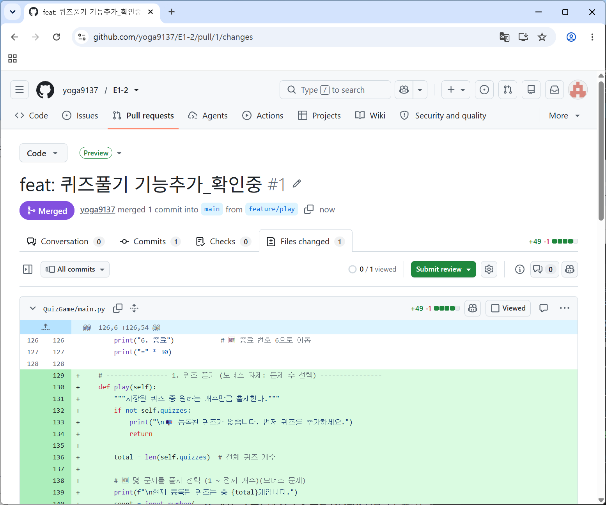

#### 3단계. (원격 브랜치 정리 및 로컬 동기화)
 병합이 완료되면 화면에 뜨는 Delete branch 버튼을 눌러 다 쓴 원격 브랜치를 삭제합니다. 이후 VS Code 터미널로 돌아와 로컬 main 브랜치를 최신화하고 로컬에 남은 브랜치도 정리합니다.

```
# main 브랜치로 이동.
hcv70714678@GNIA-C202-A06:~/projects/E1-2$ git switch main
Switched to branch 'main'
Your branch is up to date with 'origin/main'.

# 병합이 완료된 내용 가져오기.
hcv70714678@GNIA-C202-A06:~/projects/E1-2$ git pull origin main
remote: Enumerating objects: 1, done.
remote: Counting objects: 100% (1/1), done.
remote: Total 1 (delta 0), reused 0 (delta 0), pack-reused 0 (from 0)
Unpacking objects: 100% (1/1), 965 bytes | 965.00 KiB/s, done.
From https://github.com/yoga9137/E1-2
 * branch            main       -> FETCH_HEAD
   f11e009..daa3986  main       -> origin/main
Updating f11e009..daa3986
Fast-forward
 QuizGame/main.py | 50 +++++++++++++++++++++++++++++++++++++++++++++++++-
 1 file changed, 49 insertions(+), 1 deletion(-)

# 다 사용한 로컬 브랜치 삭제.
hcv70714678@GNIA-C202-A06:~/projects/E1-2$ git branch -d feature/play
Deleted branch feature/play (was efc9e32).
hcv70714678@GNIA-C202-A06:~/projects/E1-2$
```
>\> 다 사용한 원격 브랜치 삭제.

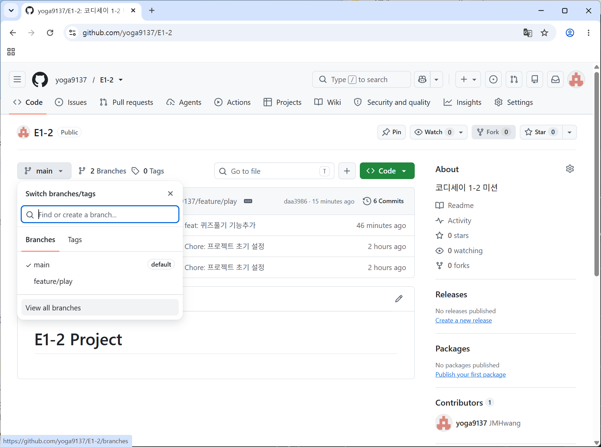

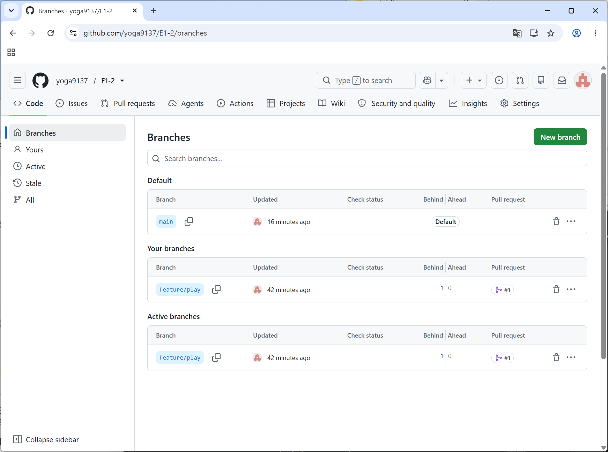

#### 2. VS Code 터미널에서 직접 병합(Merge)하는 방식

혼자 빠르게 개발할 때 GitHub 웹사이트에 접속하지 않고 터미널 명령어만으로 합치는 방법입니다.

전체 작업 순서 (시작부터 병합까지)

#### 1단계. [준비] 새 브랜치 생성 및 이동 (작업 시작 전)bash
git switch -c 새브랜치이름

#### 2단계. [작업] 코드 작성 및 수정
VS Code에서 파일을 자유롭게 만들고 고칩니다.

#### 3단계. [저장] 새 브랜치에 작업 내용 커밋 (방법 2의 1단계)bash
git add .
git commit -m "feat: 작업 내용 요약"

#### 4단계. [이동] main 브랜치로 복귀 및 최신화
git switch main
git pull origin main

#### 5단계. [병합] main에 새 브랜치 합치기
git merge 새브랜치이름

#### 6단계. [업로드 및 정리] GitHub 푸시 및 다 쓴 브랜치 삭제
git push origin main
git branch -d 새브랜치이름

#### 참고. 깃허브(원격 저장소)에 있는 브랜치 삭제
git push origin --delete feature/play

💡 두 Merge 방식 비교

|구분|	Pull Request (방법 1) |	터미널 직접 Merge (방법 2) |
|----|-----------------------|----------------------------|
|추천 상황|	팀 협업, 변경 사항 리뷰가 필요할 때, 이력 관리|	개인 프로젝트에서 빠르고 단순하게 합칠 때|
|장점|	코드 변경점을 웹 UI로 시각적 검토 가능, 충돌 사전 확인|	브라우저를 열지 않고 터미널에서 즉시 처리 가능|

## 💡 _**이후부터는 VS Code 를 사용하여 커밋함.(편의성)**_ 

### 07. 퀴즈 추가 기능 → 커밋

>\> 주의. 커밋 전에 초기에는 user.name 과 user.email 셋팅 필요함.

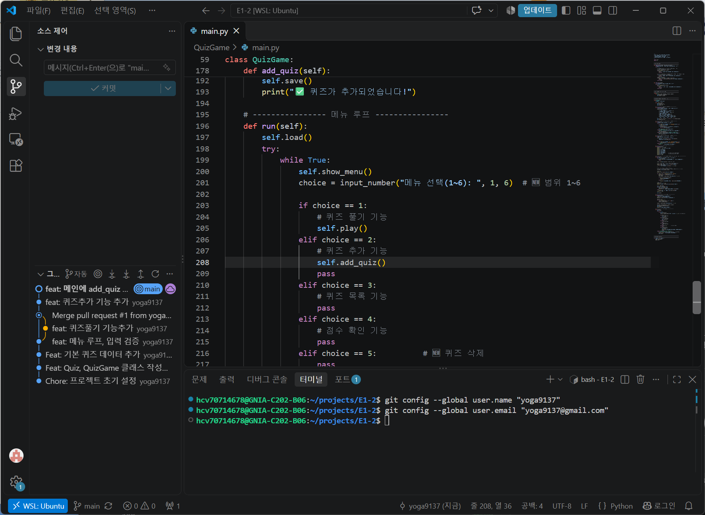

>\> GitHub 퀴즈추가 기능 추가 스크린 샷.

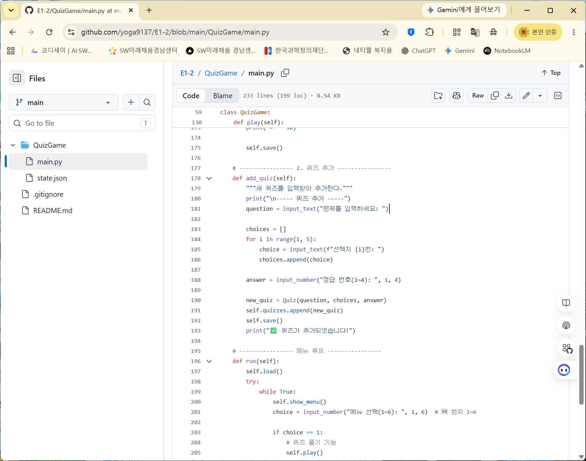

### 08. 퀴즈 목록 기능 → 커밋

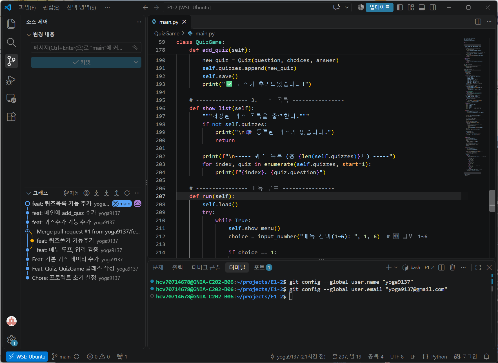

### 09. 점수 확인 + 저장 → 커밋

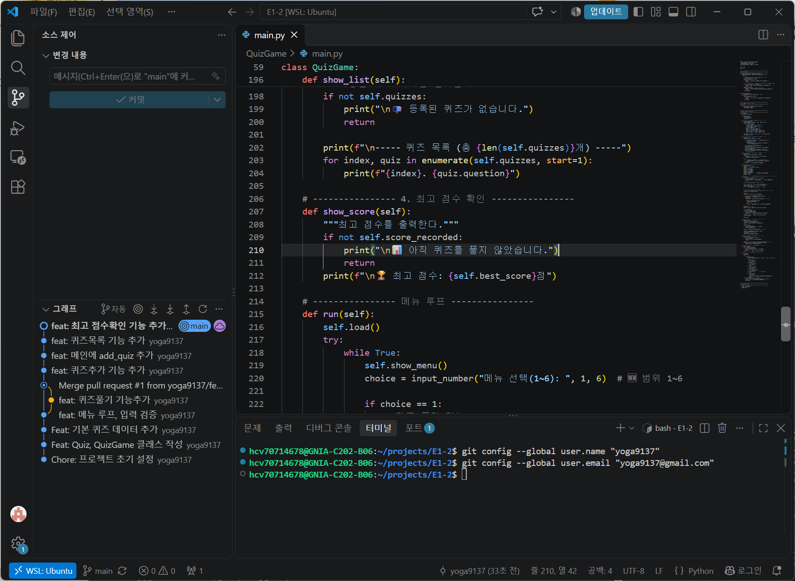

>\> 퀴즈삭제 기능 추가(보너스 문제)

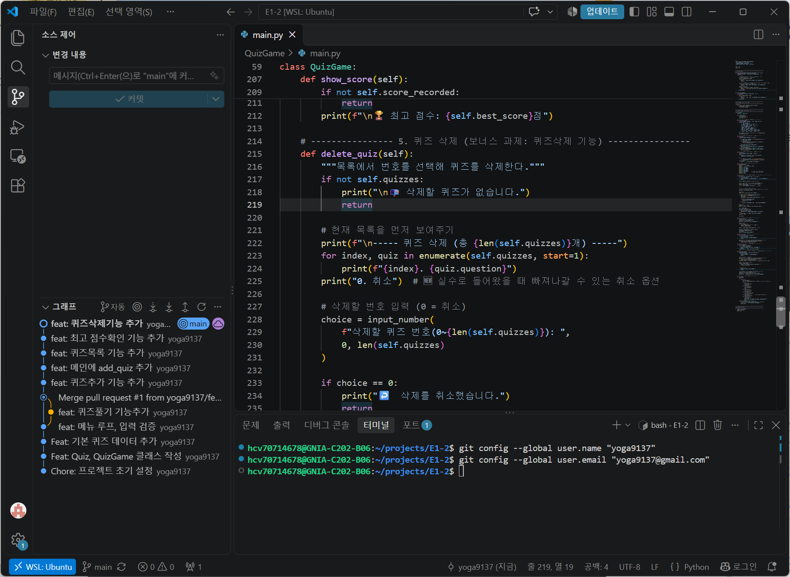

>\> 깃허브 퀴즈삭제 기능 추가 스크린 샷.

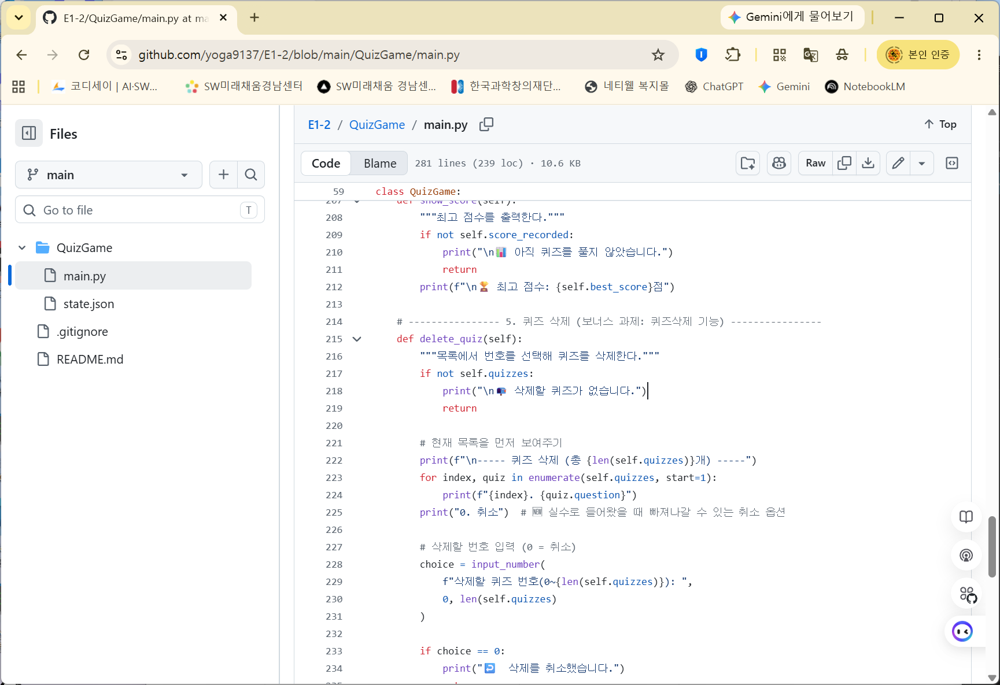

### 10. JSON 저장/불러오기 완성 → 커밋

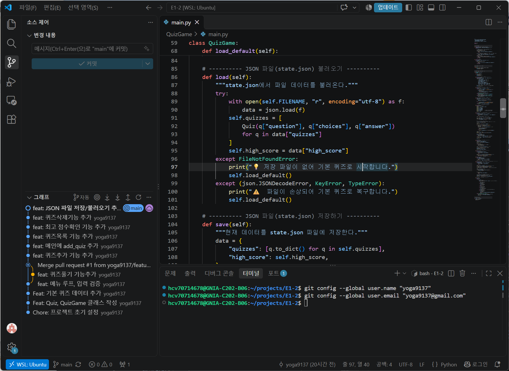

### 11. README 완성 → 푸시

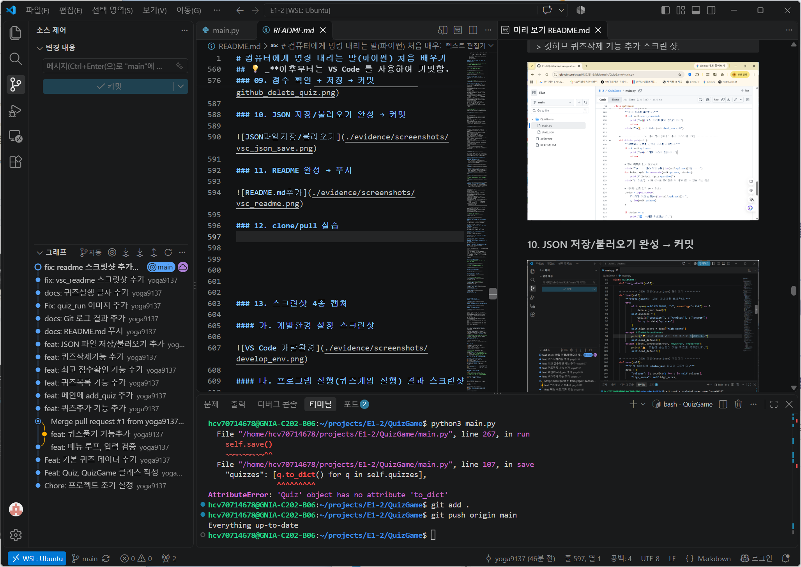

### 12. clone/pull 실습

#### 📌 git clone 과 git pull 의 차이

| 명령 | 설명 |
|------|------|
| git clone | 로컬에 아무것도 없는 상태에서 처음 프로젝트를 통째로 내려받을 때 한 번 실행합니다.|
| git pull | 이미 git clone으로 받아둔 로컬 저장소에서 이후에 업데이트된 변경 사항만 추가로 가져올 때 반복해서 실행합니다.|

#### 가. git clone 실습

git clone은 원격 저장소(GitHub, GitLab 등)에 있는 프로젝트를 내 컴퓨터(로컬 환경)로 통째로 복제해 오는 명령어입니다. 단순히 파일만 내려받는 것이 아니라 원격 저장소의 전체 커밋 히스토리, 브랜치 정보, 원격 저장소 연결 설정(origin)까지 한 번에 세팅됩니다.(_**초기 한번만 실행**_)

```
# 현재 위치에 저장소 이름(E1-2)과 동일한 폴더가 생성되고, 그 안에 전체 코드가 다운로드됨.
hcv70714678@GNIA-C202-B06:~/projects$ git clone https://github.com/yoga9137/E1-2.git
fatal: destination path 'E1-2' already exists and is not an empty directory.

# project 폴더에 이미 E1-2 폴더가 있을 경우에는 다운로드 되지않음. 따라서 기존 폴더 E1-2 삭제해야함.(주의)
hcv70714678@GNIA-C202-B06:~/projects$ rm -rf E1-2

# 기존 폴더 E1-2 삭제후, 다시 git clone 명령.
hcv70714678@GNIA-C202-B06:~/projects$ git clone https://github.com/yoga9137/E1-2.git
Cloning into 'E1-2'...
remote: Enumerating objects: 115, done.
remote: Counting objects: 100% (115/115), done.
remote: Compressing objects: 100% (91/91), done.
remote: Total 115 (delta 24), reused 110 (delta 20), pack-reused 0 (from 0)
Receiving objects: 100% (115/115), 6.59 MiB | 13.35 MiB/s, done.
Resolving deltas: 100% (24/24), done.
hcv70714678@GNIA-C202-B06:~/projects$ 
```

#### 나. git pull 실습

git pull은 원격 저장소(GitHub, GitLab 등)의 최신 변경 사항을 내 컴퓨터(로컬 저장소)로 가져와서 현재 작업 중인 브랜치에 합치는(Merge) 명령어입니다. 팀원이 올린 최신 코드를 내 작업 환경에 동기화할 때 가장 많이 사용합니다.

```
# Step 1. 수정 중인 파일이 커밋되지 않은 채로 남아 있는지 먼저 확인함. 
hcv70714678@GNIA-C202-B06:~/projects/E1-2$ git status
On branch main
Your branch is up to date with 'origin/main'.

Changes not staged for commit:
  (use "git add <file>..." to update what will be committed)
  (use "git restore <file>..." to discard changes in working directory)
        modified:   README.md

no changes added to commit (use "git add" and/or "git commit -a")

# README.md 파일(변경 파일)을 스테이징함.
hcv70714678@GNIA-C202-B06:~/projects/E1-2$ git add README.md

# 로컬 커밋 생성.
hcv70714678@GNIA-C202-B06:~/projects/E1-2$ git commit -m "README.md 수정"
[main 4fefb10] README.md 수정
 1 file changed, 27 insertions(+)

# 원격 저장소 업로드. 
hcv70714678@GNIA-C202-B06:~/projects/E1-2$ git push origin main
Enumerating objects: 5, done.
Counting objects: 100% (5/5), done.
Delta compression using up to 24 threads
Compressing objects: 100% (3/3), done.
Writing objects: 100% (3/3), 1.26 KiB | 1.26 MiB/s, done.
Total 3 (delta 2), reused 0 (delta 0), pack-reused 0 (from 0)
remote: Resolving deltas: 100% (2/2), completed with 2 local objects.
To https://github.com/yoga9137/E1-2.git
   f19d1b9..4fefb10  main -> main

# 현재 작업 상태 다시 확인.
hcv70714678@GNIA-C202-B06:~/projects/E1-2$ git status
On branch main
Your branch is up to date with 'origin/main'.

nothing to commit, working tree clean

# Step 2. 현재 브랜치 위치 확인.
내가 코드를 합치고자 하는 정확한 브랜치(main, develop 등)의 위치에 있는지 확인.
hcv70714678@GNIA-C202-B06:~/projects/E1-2$ git branch
* main

# Step 3. 원격 저장소의 최신 변경 코드 당겨오기.
# git pull : 현재 브랜치와 연결된 원격 브랜치의 내용을 그대로 가져와 병합.
# git pull origin main : 원격 저장소(origin)의 특정 브랜치(main)의 내용을 현재 내 브랜치로 가져옴.
hcv70714678@GNIA-C202-B06:~/projects/E1-2$ git pull origin main
From https://github.com/yoga9137/E1-2
 * branch            main       -> FETCH_HEAD
Already up to date.
hcv70714678@GNIA-C202-B06:~/projects/E1-2$
```

### 13. 스크린샷 4종 캡처

#### 가. 개발환경 설정 스크린샷

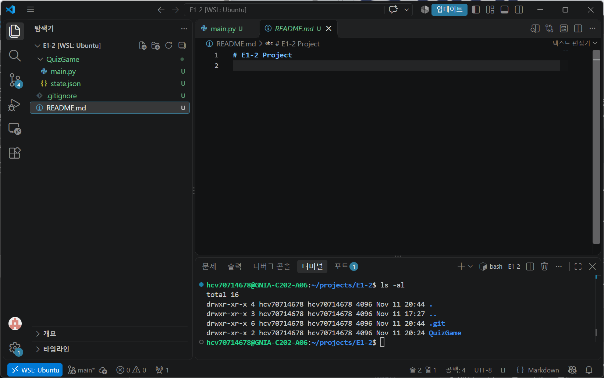

#### 나. 프로그램 실행(퀴즈게임 실행) 결과 스크린샷

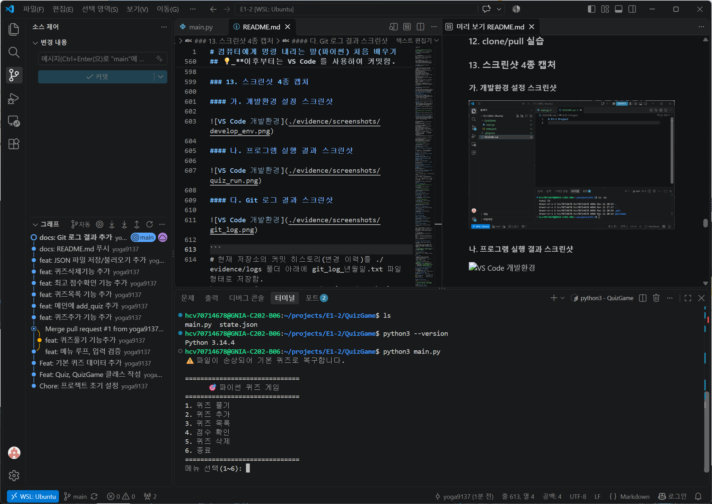

#### 다. Git 로그 결과 스크린샷

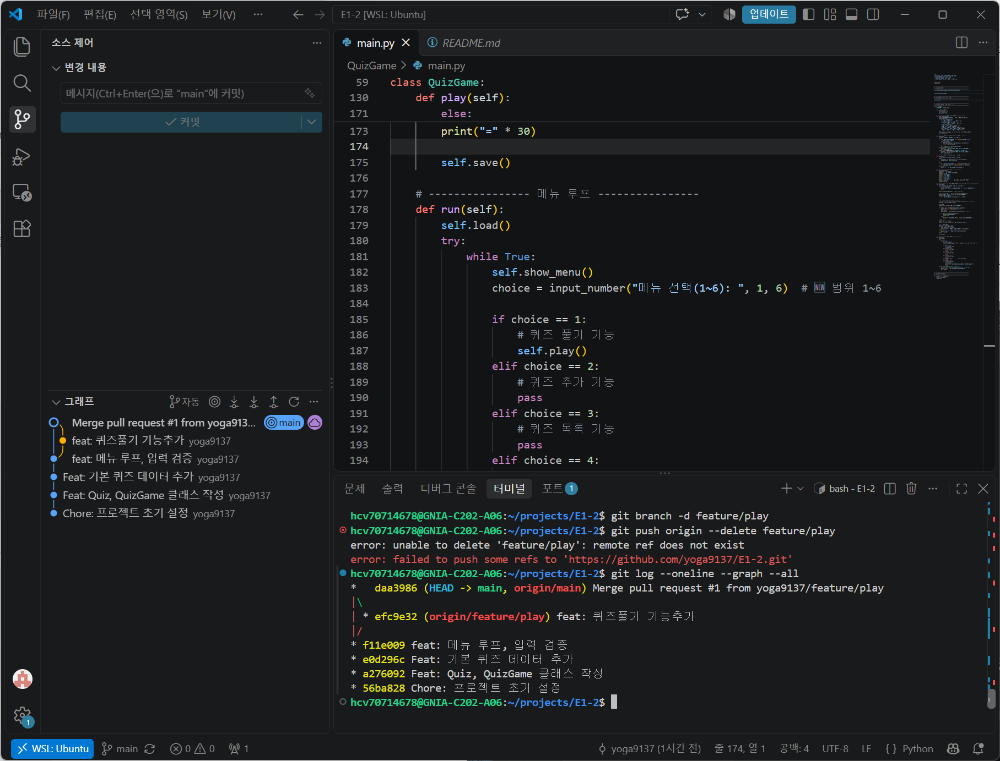

```
# 현재 저장소의 커밋 히스토리(변경 이력)를 ./evidence/logs 폴더 아래에 git_log_년월일.txt 파일 형태로 저장함.
hcv70714678@GNIA-C202-B06:~/projects/E1-2$ git log --oneline > ./evidence/logs/git_log_$(date +%Y%m%d).txt

# 저장된 로그를 확인.
hcv70714678@GNIA-C202-B06:~/projects/E1-2$ ls -al ./evidence/logs/
total 12
drwxr-xr-x 2 hcv70714678 hcv70714678 4096 Nov 12 20:03 .
drwxr-xr-x 4 hcv70714678 hcv70714678 4096 Nov 12 19:49 ..
-rw-r--r-- 1 hcv70714678 hcv70714678  567 Nov 12 20:03 git_log_20261112.txt
```

## 📖 콘솔 퀴즈 게임 프로젝트 개요 (파이썬)

이 프로그램은 터미널에서 실행하는 **콘솔 퀴즈 게임**입니다.

- 메뉴에서 번호를 선택해 퀴즈를 **풀고, 추가하고, 목록을 보고, 점수를 확인**할 수 있습니다.
- 프로그램을 **껐다 켜도** 내가 추가한 퀴즈와 최고 점수가 그대로 유지됩니다. (→ `state.json` 파일에 저장되기 때문)

> 💡 이 프로젝트의 목표는 "문법을 아는 것"을 넘어서
> **하나의 프로그램을 처음부터 끝까지 완성하는 경험**을 하는 것입니다.

## 🗂️ 퀴즈 주제와 선정 이유

- **주제**: 기본 상식 퀴즈 맞추기
- **선정 이유**: 글로벌 시대에 다양한 상식을 아는 건 기본

## 💻 개발 환경

- **운영체제**: Windows + WSL2 (Ubuntu)
- **에디터**: VS Code (WSL 원격 연결)
- **언어**: Python 3.10 이상
- **외부 라이브러리**: 없음 (표준 라이브러리 `json` 등만 사용)
- **버전 관리**: Git & GitHub

> 📌 이 프로젝트는 **WSL2(Ubuntu) 안에서 개발**합니다.
> 윈도우 디스크(`/mnt/c/...`)가 아닌 **리눅스 홈 디렉터리(`/home/...`)** 에서 작업하는 이유:
> - **속도**: WSL 내부 파일 처리 속도가 훨씬 빠름
> - **Git 호환성**: 줄바꿈/권한 문제 없음
> - **실무 동일**: 대부분의 서버 환경이 리눅스

## ⚙️ 개발 환경 설정 (처음 시작하는 초보자 기준)

### 1단계. VS Code를 WSL에 연결하기
1. VS Code 실행
2. 왼쪽 아래 **파란색 `><` 버튼** 클릭
3. **"Connect to WSL"** 선택
4. 왼쪽 아래에 **`WSL: Ubuntu`** 표시가 뜨면 성공 ✅

### 2단계. 프로젝트 폴더 만들기
VS Code 터미널(`` Ctrl + ` ``)에서 입력:
```bash
cd ~                          # 홈 디렉터리로 이동
mkdir -p E1-2/QuizGame        # 프로젝트 폴더 생성
cd E1-2/QuizGame              # 폴더로 이동
pwd                           # 위치 확인 → /home/사용자명/E1-2/QuizGame
```

### 3단계. VS Code로 폴더 열기
```bash
code .    # 현재 폴더를 VS Code로 열기
```
> 💡 WSL2(Ubuntu) 안에서 바로 VS Code 실행방법
> - "code ." <---- code 와 '.' 사이는 공백 필요.

### 4단계. 필요한 파일 만들기
```bash
touch main.py README.md .gitignore
```

## 🔧 Git & GitHub 연동

프로젝트 폴더(WSL2 터미널)에서 순서대로 실행함.

```bash
# 1. Git 저장소 초기화
git init

# 2. 사용자 정보 설정 (최초 1회만)
git config --global user.name "[깃허브 사용자 계정]"
git config --global user.email "[깃허브 사용자 이메일]"

# 3. 파일 추가 & 첫 커밋
git add .
git commit -m "first commit: 프로젝트 초기 설정"

# 4. GitHub 저장소와 연결 (GitHub에서 저장소 먼저 생성)
git remote add origin [사용자의 GitHub 저장소 주소]
git branch -M main
git push -u origin main
```

> 💡 **`.gitignore` 작성 예시** (저장 파일/캐시는 올리지 않기)
> ```
> __pycache__/
> *.pyc
> state.json
> ```

## 🚀 실행 방법

### 1. 준비물
```bash
python3 --version   # Python 3.10 이상인지 확인
```
> 💡 **Python3 및 패키지 관리자(pip) 설치**
> ```
> sudo apt install python3 python3-pip python3-venv -y 
> ```


### 2. 프로젝트 내려받기 (다른 PC에서 받을 때)
```bash
git clone [사용자의 GitHub 저장소 주소]
cd [프로젝트 폴더 이름]
```

### 3. 실행하기
```bash
python3 main.py
```

### 4. 종료하기
메뉴에서 **5번(종료)** 선택, 또는 `Ctrl + C` 로도 안전하게 종료됩니다.

## 🕹️ 기능 목록

| 메뉴 | 기능 | 설명 |
|------|------|------|
| 1 | **퀴즈 풀기** | 저장된 퀴즈를 풀고 정답/오답과 최종 점수를 보여줍니다. |
| 2 | **퀴즈 추가** | 문제, 선택지 4개, 정답 번호를 입력해 새 퀴즈를 만듭니다. (자동 저장) |
| 3 | **퀴즈 목록** | 저장된 퀴즈들을 한눈에 볼 수 있습니다. |
| 4 | **점수 확인** | 지금까지의 최고 점수를 보여줍니다. |
| 5 | **퀴즈 삭제** | 저장된 퀴즈 목록에서 퀴즈를 삭제합니다.(보너스 문제) |
| 6 | **종료** | 데이터를 저장하고 프로그램을 끝냅니다. |

✅ **잘못된 입력 처리**
- 빈 값, 숫자가 아닌 글자, 범위를 벗어난 숫자 입력 시 안내 후 **다시 입력**하도록 합니다.

## 📁 파일 구조

```
E1-2/
├─QuizGame/
│  ├─ evidence/
│  │  ├─ screenshots/
│  │  └─ logs/
│  ├── main.py      # 프로그램 실행 파일 (게임 시작점)
│  └── state.json   # 퀴즈 데이터와 최고 점수 저장 파일(실행시 자동생성)
└── README.md       # 프로젝트 설명 파일 (지금 이 문서)
```

## 🧩 코드 구조 (클래스 설명)

이 프로그램은 **2개의 클래스**로 역할을 나눴습니다.

- **`Quiz` 클래스**: 퀴즈 1개를 표현
  - 속성: 문제(`question`), 선택지(`choices`), 정답(`answer`)
  - 메서드: 문제 출력(`show`), 정답 확인(`is_correct`) 등

- **`QuizGame` 클래스**: 게임 전체를 관리
  - 속성: 퀴즈 목록(`quizzes`), 최고 점수(`best_score`)
  - 메서드: 메뉴 표시, 퀴즈 풀기, 추가, 목록, 점수, 파일 저장/불러오기

## 💾 데이터 파일 설명 (state.json)

- **경로**: 프로젝트 루트의 `state.json`
- **역할**: 퀴즈 데이터와 최고 점수를 저장해 **프로그램을 껐다 켜도 유지**
- **인코딩**: UTF-8 (한글 깨짐 방지)

### 1. 저장 형식 (스키마)
```json
{
  "quizzes": [
    {
      "question": "대한민국의 수도는?",
      "choices": ["부산", "서울", "대구", "인천"],
      "answer": 2
    }
  ],
  "best_score": 5
}
```

| 키 | 의미 |
|------|------|
| `quizzes` | 퀴즈 목록 (문제 / 선택지 4개 / 정답 번호) |
| `answer` | 정답 번호 (1~4) |
| `best_score` | 지금까지의 최고 점수 |

> 🔧 **파일이 없거나 손상된 경우**
> - 파일이 없으면 → 기본 퀴즈로 시작
> - 파일이 손상되었으면 → 안내 메시지 후, 기본 퀴즈로 복구

## 👤 만든 사람

- **이름**: GN루키마리너_황재문
- **GitHub**: [\[퀴즈게임 GitHub 주소\]](https://github.com/yoga9137/E1-2.git)
